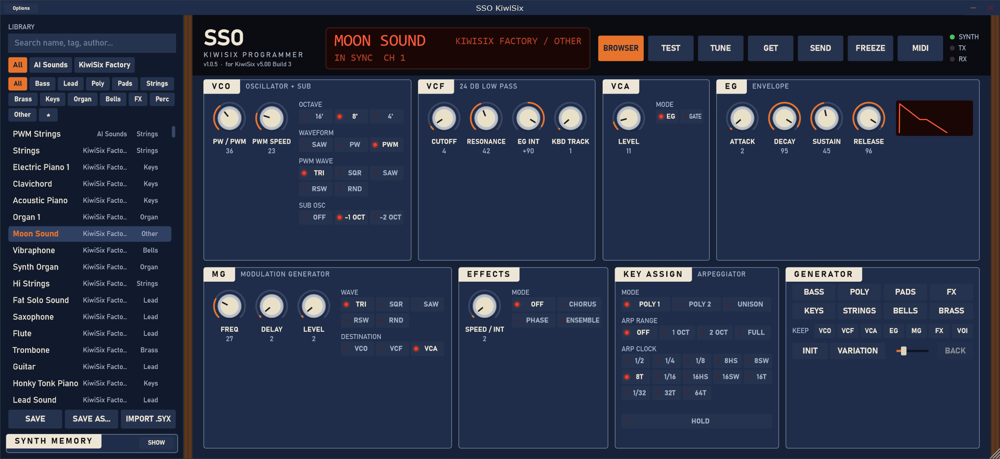
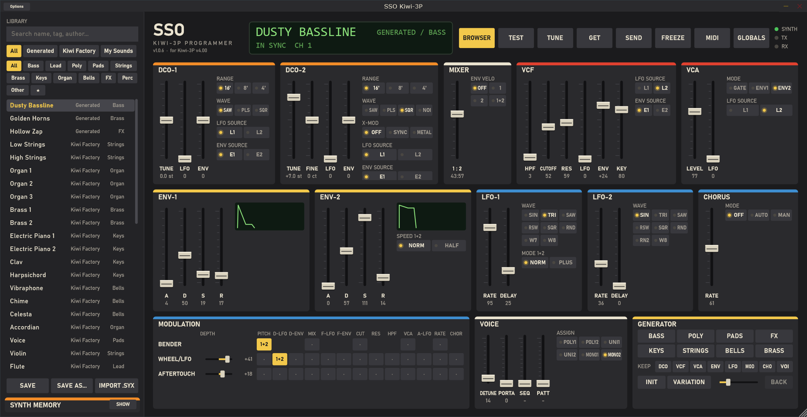
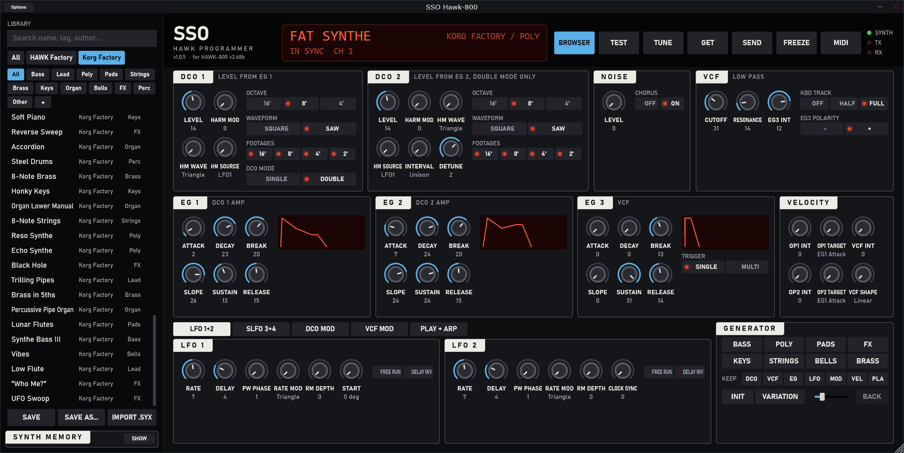

# Smooth Synth Operator

Modern software programmers for vintage synthesizers with modern upgrades —
standalone app and VST3 plugin for Windows.



| App | Synth | Upgrade | Made and tested with |
|---|---|---|---|
| **SSO Kiwi-3P** | Roland JX-3P | KiwiTechnics Kiwi-3P | Kiwi-3P v4.00 |
| **SSO KiwiSix** | Korg PolySix | KiwiTechnics KiwiSix | KiwiSix v5.00 Build 3 |
| **SSO Hawk-800** | Korg Poly-800 (MK1) | HAWK-800 | HAWK-800 v2.68b |

The apps talk to the upgrade's MIDI implementation (CC and SysEx); the synth needs the upgrade.
SSO Kiwi-3P is inspired by the Retroaktiv PG-2K.

## Features

- **Every sound parameter on one screen**, in the look of the synth, editable and automatable in
  the DAW - including the upgrades' extra parameters (Kiwi-3P: all 87 tone parameters with the
  modulation matrix; KiwiSix: 12-bit knobs; HAWK-800: all 64 original and 64 extended parameters)
- **Get and send**: fetch the synth's current sound, send sounds to its edit buffer; edits go out
  in real time; FREEZE holds them back
- **Preset library** with banks, categories, tags, favorites and search; `.syx` import;
  undocumented values survive editing
- **Synth memory view**: read all memories, store sounds by drag and drop with read-back
- **Sound generator** with 8 categories, KEEP masks for the sections you like, variations and history
- **TEST** phrase to hear the sound, All Sound Off before switching sounds
- **TUNE**: the synth plays an A with a plain waveform while the app plays the same tone at
  440 Hz (adjustable level) - tuning an old synth by ear has never been easier; the sound comes
  back afterwards
- **Plugin**: the sound is saved with the project and sent when it opens; the track's notes are
  played on the synth; one instance per synth (others grey out, TAKE OVER by click)
- **MIDI loop protection**
- **AI control (optional)**: AI assistants such as Claude can read and set every parameter, play
  notes, and use library and generator - see [docs/ai-control.md](docs/ai-control.md)

| SSO Kiwi-3P | SSO Hawk-800 |
|---|---|
|  |  |

## Versions

Each app shows its version under the logo, with the synth firmware it was made and tested
with (e.g. "v1.0.0 · for HAWK-800 v2.68b"). The first two numbers are set by hand in the app's
`VERSION` file: the first for a complete rework, a new framework or new synth firmware, the
second for larger changes. The third counts itself: the commits that changed the app's code
(its folder, its device modules, `framework/sso_core`) since `VERSION` last changed - same
code, same number.

## Troubleshooting

Problems such as a detected MIDI loop are written to `%TEMP%\SSO-ownership\ownership.log`.
For step-by-step details (which instance owns the synth and why), create an empty file
`%TEMP%\SSO-ownership\verbose` and restart the app or host.

## Building (Windows)

Requires Visual Studio 2022 (C++ workload) and CMake ≥ 3.22.

```
git clone --recurse-submodules https://github.com/Helge666/smooth-synth-operator.git
cd smooth-synth-operator
cmake -S . -B build -G "Visual Studio 17 2022" -A x64
cmake --build build --config Release
```

The standalone apps end up in `build\apps\<app>\<target>_artefacts\Release\Standalone`. To
install the VST3 plugins, run `install-vst3.ps1` from an administrator PowerShell
(`powershell -ExecutionPolicy Bypass -File .\install-vst3.ps1`).

## Layout

| Path | Content |
|---|---|
| `framework/sso_core` | Device-independent JUCE module: parameter model, MIDI, controller, generic GUI, library, generator, AI control |
| `devices/sso_kiwitechnics` | SysEx handling shared by KiwiTechnics upgrades |
| `devices/sso_kiwi3p`, `devices/sso_kiwisix`, `devices/sso_hawk800` | Device definitions and sound generators |
| `apps/SSO-Kiwi3P`, `apps/SSO-KiwiSix`, `apps/SSO-Hawk800` | Standalone + VST3 plugins (device panel only; processor/editor live in `sso_core/plugin`) |
| `tests` | Unit tests and a hardware test (`SSO_Tests --hardware "<port name part>"`) |
| `docs` | Measured MIDI behaviour of the Kiwi-3P, the KiwiSix and the HAWK-800, AI control guide |

## License

AGPLv3 (JUCE is used under its AGPLv3 option) - see [LICENSE](LICENSE).

Roland, JX-3P, Korg, PolySix and Poly-800 are trademarks of their respective owners. Kiwi-3P and
KiwiSix are upgrades by KiwiTechnics, HAWK-800 is an upgrade for the Poly-800 by its own
developers. This project is independent and not affiliated with any of them.
